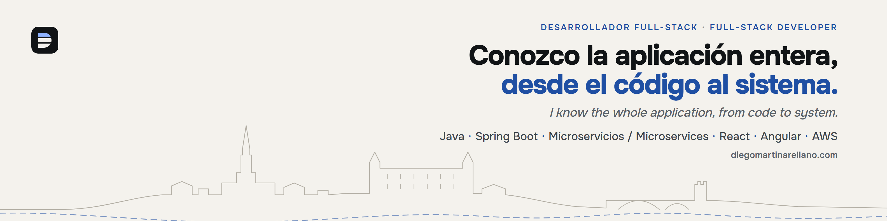

  <a href="https://github.com/diegoma2933">Español</a> · <strong>English</strong>

  

<h1 align="center">Hi! 👋 I'm Diego Martín Arellano</h1>

  <strong>Full-Stack Developer</strong> · Java · Spring Boot · React · AWS

  &nbsp;&nbsp;
  &nbsp;&nbsp;
  &nbsp;&nbsp;
  

 

## 👨‍💻 About me

I am passionate about technology. I specialise in full-stack development and systems administration, with a main focus on building and maintaining web applications.

I build web applications with **Java, Spring Boot, React and AWS**. I currently work on a **Market Risk project for BBVA**. I have worked in consulting for banking, logistics and the public sector, always in agile teams.

I am motivated by high-impact projects. I also keep learning continuously to improve my skills and adapt to new tools and methodologies.

 

## 🛠️ Technologies

| Area | Technologies |
|---|---|
| **Backend** |          |
| **Frontend** |         |
| **Testing** |      |
| **Databases** |    |
| **Cloud & DevOps** |         |
| **Systems & networking** |      |
| **Artificial intelligence** |  |
| **Way of working** |       |

 

## 🚀 Projects

My own applications.

| Project | What it is | Status |
|---|---|:---:|
| **[Planexa](https://planexa.dimawebapp.com/)** | Agile project management with a 3D virtual office. | 🟢 Live |
| **[Trackora](https://trackora.dimawebapp.com/)** | Private area where clients follow their projects. | 🟢 Live |
| **[Gestempo](https://gestempo.dimawebapp.com/)** | HR, invoicing and professional AI invoice reading. | 🟢 Live |
| **[Apañao'](https://apanao-app.dimawebapp.com/)** | Organise your day to day: shopping, meals, tasks and more. | 🟢 Live |
| **[Asesoría Javier](https://www.asesoriajavier.es/)** | Website for a labour, tax, accounting and legal advisory firm. | 🟢 Live |
| **[DimaWebApp](https://www.dimawebapp.com)** | My custom software company: websites, applications and automation. | 🟢 Live |
| **[Portfolio](https://www.diegomartinarellano.com/en)** | Website about my professional career. | 🟢 Live |
| **Barbelite** | Bookings and appointment management for barbershops and their clients. | 🟡 Coming soon |
| **MyFinance** | Personal finance: income, expenses, savings and more. | 🔒 Private |
| **FundSelector** | Efficient, well-founded investment fund selection. | 🔒 Private |

 

## 📊 GitHub Stats

  &nbsp;&nbsp;
  

 

  <strong>Shall we talk?</strong> Write to me at <a href="mailto:diegoma2933@gmail.com">diegoma2933@gmail.com</a> or visit <a href="https://www.diegomartinarellano.com/en">diegomartinarellano.com</a> 🚀

