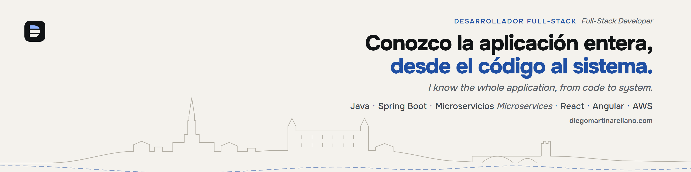

  

<h1 align="center">¡Hola! 👋 Soy Diego Martín Arellano</h1>

  <strong>Full-Stack Developer</strong> · Java · Spring Boot · React · AWS

  
  
  
  

---

## 👨‍💻 Sobre mí

Me apasiona la tecnología. Estoy especializado en el desarrollo full-stack y la administración de sistemas, con un enfoque principal en la programación y el mantenimiento de aplicaciones web.

Desarrollo aplicaciones web con **Java, Spring Boot, React y AWS**. Actualmente trabajo en un proyecto de **Riesgos de Mercado de BBVA**.

He trabajado en consultoría para banca, logística y administración pública, siempre en equipos ágiles.

Tengo dos grados superiores: **Desarrollo de Aplicaciones Web (DAW)** y **Administración de Sistemas Informáticos en Red (ASIR)**.

Me formo de manera continua para mejorar mis habilidades y adaptarme a nuevas herramientas y metodologías. Me motiva participar en proyectos de alto impacto.

| | |
|---|---|
| 💼 **Ahora** | Full-Stack Developer en **Arktic** · Cliente: **BBVA** · Riesgos de Mercado |
| ⏱️ **Experiencia** | Más de 4 años como full-stack |
| 🎓 **Formación** | DAW + ASIR · IES Azarquiel |
| 🌍 **Idiomas** | Español nativo · Inglés intermedio |

---

## 🛠️ Tecnologías

**Backend**

**Frontend**

**Pruebas**

**Bases de datos**

**Cloud y DevOps**

**Sistemas y redes**

**Inteligencia artificial**

**Forma de trabajar**

---

## 💼 Experiencia

**Full-Stack Developer · Arktic** — Cliente: BBVA · Riesgos de Mercado · _Mar 2026 — Actualidad_ 
Plataforma de riesgo de mercado de BBVA: nuevos desarrollos, mantenimiento y soporte.

- Backend con microservicios en Java y Spring Boot; frontend en React, HTML y CSS.
- Desarrollo y administración de bases de datos PostgreSQL y MySQL.
- Infraestructura y procesos en AWS de principio a fin.
- Contenedores con Docker y Kubernetes.
- Monitorización y trazabilidad con las herramientas de AWS y Grafana.
- Desarrollo asistido por IA.
- Control de versiones e integración continua con Git, GitHub, Bitbucket, Jenkins y Jira.

**Full-Stack Developer · MyCargoGate** — _Abr 2024 — Mar 2026_ 
Aplicaciones web de la propia empresa: nuevos desarrollos, mantenimiento y soporte.

- Backend con microservicios en Java y Spring Boot; frontend en Angular, React, HTML y CSS.
- Desarrollo y administración de bases de datos PostgreSQL y MySQL.
- Infraestructura y procesos en AWS de principio a fin.
- Monitorización y trazabilidad con las herramientas de AWS y Grafana.
- Control de versiones e integración continua con Git, Bitbucket, Jenkins y Jira.

**Full-Stack Developer · Atos** — Cliente: Junta de Comunidades de Castilla-La Mancha · _Feb 2022 — Abr 2024_ 
Tramitador de la Junta: nuevos desarrollos, mantenimiento y soporte.

- Backend en Java con Maven, Struts e Hibernate; frontend en JSP, HTML y CSS.
- Desarrollo y administración de bases de datos Oracle con PL/SQL.
- Documentos dinámicos para la ciudadanía con Oracle Report Builder.
- Control de versiones con SVN e integración continua con Jenkins.

**Desarrollador web y técnico informático · Inforcopy** — _Jul 2020 — Jul 2021_ 
Webs de la empresa, administración de sistemas y soporte técnico.

**Prácticas de Administración de sistemas (ASIR) · Fibercli** — _Abr 2020 — Jun 2020_ 
Administración de sistemas y redes.

**Desarrollador web y técnico informático · Madrid Invest** — _Jun 2018 — May 2019_ 
Webs oficiales, administración de sistemas y soporte técnico en eventos.

---

## 🚀 Proyectos

Aplicaciones propias que he desarrollado.

| Proyecto | Qué es | Estado |
|---|---|---|
| **[Planexa](https://planexa.dimawebapp.com/)** | Gestión de proyectos ágiles con oficina virtual en 3D. | 🟢 Publicado |
| **[Trackora](https://trackora.dimawebapp.com/)** | Área privada donde los clientes siguen sus proyectos. | 🟢 Publicado |
| **[Gestempo](https://gestempo.dimawebapp.com/)** | RR. HH., facturación y lectura de facturas con IA profesional. | 🟢 Publicado |
| **[Asesoría Javier](https://www.asesoriajavier.es/)** | Web de una asesoría laboral, fiscal, contable y legal. | 🟢 Publicado |
| **[DimaWebApp](https://www.dimawebapp.com)** | Mi empresa de software a medida: webs, aplicaciones y automatización. | 🟢 Publicado |
| **[Porfolio](https://www.diegomartinarellano.com)** | Web sobre mi carrera profesional. | 🟢 Publicado |
| **Barbelite** | Reservas y gestión de citas para barberías y clientes. | 🟡 Próximamente |
| **MyFinance** | Finanzas personales: ingresos, gastos, ahorros, etc. | 🔒 Privado |
| **Apañao'** | Organiza tu día a día: compra, menú, tareas, etc. | 🔒 Privado |
| **FundSelector** | Optimización y eficacia para la selección de fondos con criterio. | 🔒 Privado |

---

## 🎓 Formación, certificaciones y cursos

- 🎓 **Técnico Superior en Desarrollo de Aplicaciones Web (DAW)** · IES Azarquiel · 2020 — 2022
- 🎓 **Técnico Superior en Administración de Sistemas Informáticos en Red (ASIR)** · IES Azarquiel · 2018 — 2020
- 🏅 **Cisco CCNA** · Cisco Networking Academy
- 🏅 **React: creando webapp Full Stack con Spring Boot** · Udemy
- 🏅 **Angular & Spring Boot: Creando web app Full Stack** · Udemy
- 📘 **MikroTik MTCNA** · MikroTik Academy

---

## 📊 GitHub Stats

  
  

---

  <strong>¿Hablamos?</strong> Escríbeme a <a href="mailto:diegoma2933@gmail.com">diegoma2933@gmail.com</a> o visita <a href="https://www.diegomartinarellano.com">diegomartinarellano.com</a> 🚀

